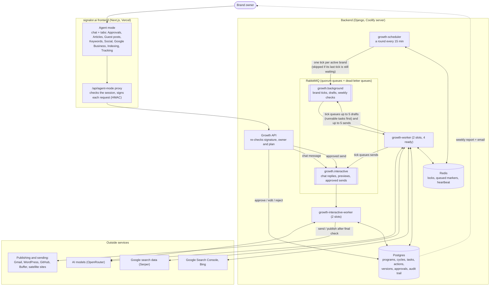
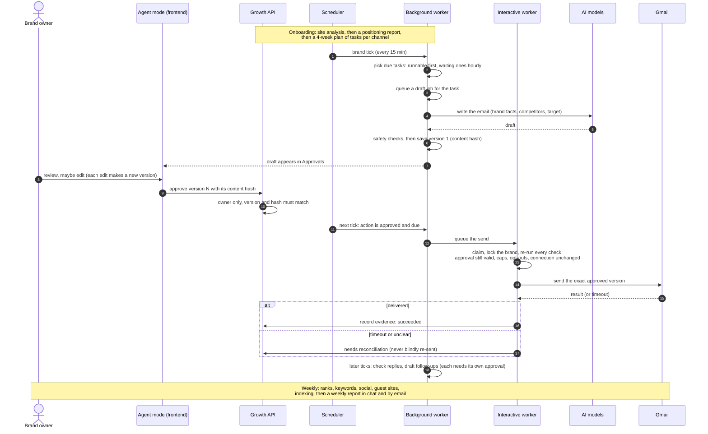

# How the signalor.ai agent works

Two diagrams.
The first shows the parts and how work moves between them.
The second follows one outreach email from plan to sent.
Both describe production as of 2026-11-24.

## 1. System overview

## 2. One outreach email, start to finish

## Key rules the diagrams encode

- Nothing is sent or published without the owner approving that exact version.
- An edit creates a new version and needs a fresh approval.
- The final check runs again right before sending, under the brand's lock.
- An unclear send outcome goes to reconciliation; it is never retried blindly.
- Chat replies and approved sends never wait behind drafts or site analyses.
- One brand can't use up a whole round: at most 5 drafts and 5 sends per brand per round.
